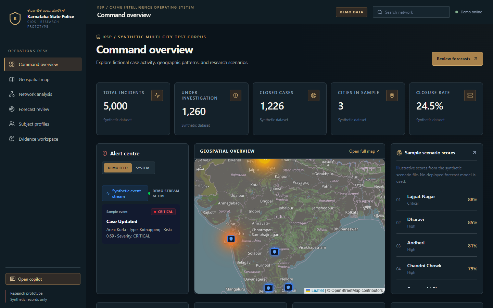
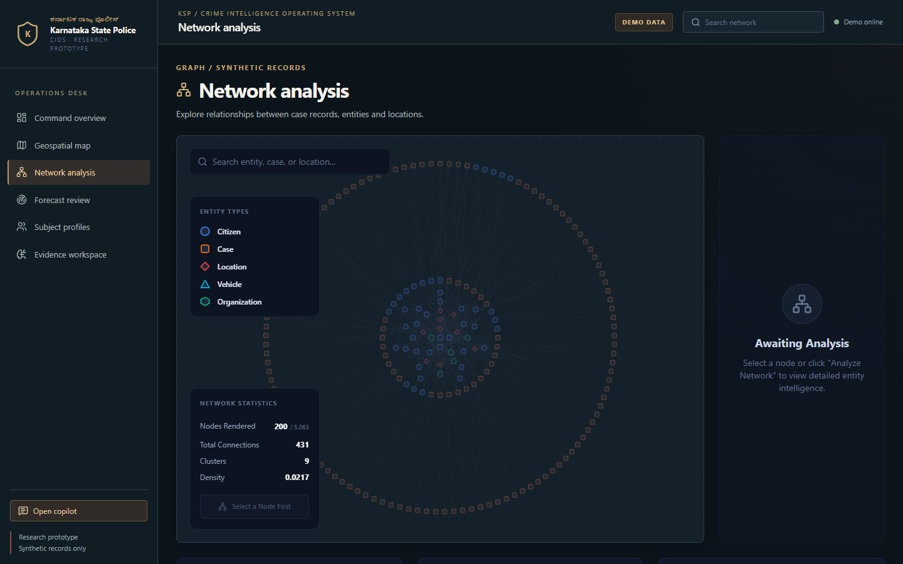
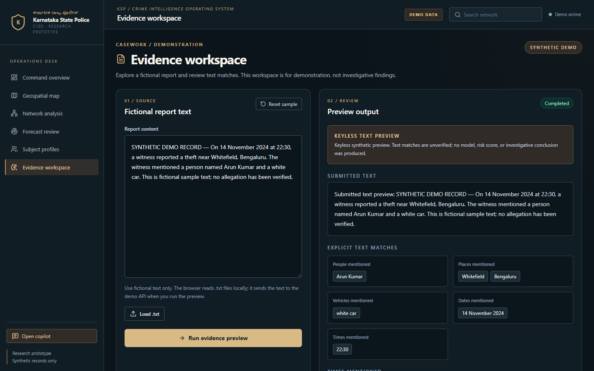

# CIOS · Crime Intelligence Operating System

**A synthetic research demo for a Karnataka State Police use case.** Explore case records, map layers, graph relationships, sample scenarios, and a keyless evidence preview. This repository is a portfolio demonstration, not an official police product or an operational decision system.

**No API key is needed to run the public demo.** The sample data is fictional and the interface labels model outputs that are unavailable.



| Network analysis | Evidence workspace |
| --- | --- |
|  |  |

The screenshots were captured from the local demo. The bundled test corpus covers multiple Indian cities and its generated coordinates have not been validated for geographic accuracy.

## What visitors can try

| Screen | Keyless demo behavior |
| --- | --- |
| Command overview | Counts and charts computed from bundled synthetic CSV records; synthetic event stream. |
| Geospatial map | Browse generated incident, patrol, and camera markers. |
| Network analysis | Inspect entity and case links in a synthetic NetworkX graph. |
| Forecast review | View illustrative scenario scores, recorded sample trends, and sample composition. The anomaly form returns matching synthetic record counts when a model is unavailable. |
| Subject profiles | Search the synthetic graph; model-dependent person risk output is unavailable in the public demo. |
| Evidence workspace | Run a deterministic text preview on the fictional sample FIR or another synthetic `.txt` file. It extracts explicitly matched names, places, dates, and times without a Gemini key. |
| Copilot | A keyless bilingual guide to the demo screens. It does not make live threat claims. |

### Five-minute walkthrough

1. Start on **Command overview** to see the synthetic corpus and demo feed.
2. Open **Network analysis** and select a node to inspect its sample links.
3. Open **Forecast review** and use **Review Sample** to compare chosen conditions with the bundled records.
4. Open **Evidence workspace**, keep the preloaded fictional report, and click **Run evidence preview**.
5. Ask the copilot about the map, network, forecasts, or evidence workspace.

## Neural networks and model status

This repository includes **neural network research code**, including a graph neural network (GNN) experiment and an MLP experiment, alongside Prophet, XGBoost, and Isolation Forest experiments. Their presence in the repository does **not** mean the public demo runs them. The GNN inference path is disabled because its validation showed schema leakage. The deployed Docker images omit saved model artifacts and use a lightweight runtime. The visible graph uses NetworkX baseline analysis; the forecast screen uses synthetic scenario inputs and recorded sample counts. The evidence preview uses deterministic text matching when no key is configured.

No displayed score is a validated operational forecast, person-risk assessment, or investigative finding. See [dataset provenance](Dataset/DATA_ORIGIN.md) and the research code under `ai-services/models/` and `graph-service/prediction/` for the experimental work.

## Architecture

| Component | Directory | Role |
| --- | --- | --- |
| Next.js frontend | `frontend/` | UI and same-origin API proxy |
| AI services | `ai-services/` | Synthetic CSV endpoints, demo stream, scenarios, copilot guide |
| Graph service | `graph-service/` | NetworkX graph and link analysis |
| Evidence engine | `ai-services/evidence-engine/` | Keyless preview; optional Gemini processing |
| Synthetic data | `Dataset/` | Fictional test records and provenance |
| API contracts | `contracts/` | API sketches for the research modules |

The browser talks only to the Next.js `/api/services/*` proxy. The proxy connects to the three Python services. The demo uses CSV files; it does not need a database.

## Run locally

Install Docker Desktop or Docker Engine with Compose, then run from the repository root:

```sh
docker compose up --build -d
docker compose ps
```

Open <http://localhost:3000>. Check the services with `docker compose logs -f ai-services`, `graph-service`, or `evidence-engine` if a page remains empty. The keyless evidence preview and copilot guide work without any secrets.

For frontend development without Docker, use Node.js 22 in `frontend/`:

```sh
npm ci
npm run dev
```

The frontend expects `AI_SERVICE_URL`, `GRAPH_SERVICE_URL`, and `EVIDENCE_SERVICE_URL` as **server-side** environment variables. Their local defaults are ports 8000, 8001, and 8002. Run each FastAPI service separately if you use this path.

## Deploy the demo

1. In Render, choose **New → Blueprint**, connect this repository, and deploy the root [render.yaml](render.yaml). It creates `ksp-ai-services`, `ksp-graph-service`, and `ksp-evidence-engine`. Wait for each `/health` URL to respond.
2. In Vercel, import the same GitHub repository. Set **Root Directory** to `frontend` and **Framework Preset** to Next.js.
3. In Vercel project **Settings → Environment Variables**, set these for Production using the actual Render origins, without a trailing path:

   | Variable | Value |
   | --- | --- |
   | `AI_SERVICE_URL` | `https://<your-ai-service>.onrender.com` |
   | `GRAPH_SERVICE_URL` | `https://<your-graph-service>.onrender.com` |
   | `EVIDENCE_SERVICE_URL` | `https://<your-evidence-service>.onrender.com` |

4. Deploy Vercel. If you add or change variables afterward, redeploy. Check `/api/services/ai/health`, `/api/services/graph/health`, and `/api/services/evidence/health` on the Vercel domain, then run the evidence preview.

### Optional Gemini processing

The public demo works without Gemini. If you want model-assisted evidence processing, set `GEMINI_API_KEY` **only** on the Render `ksp-evidence-engine` service, then redeploy it. Never commit a key or add it to a `NEXT_PUBLIC_` variable. The copilot remains a keyless demo guide. Local `.env*` files are ignored by Git.

## Scope and safety

- All bundled records are synthetic. Do not upload real FIRs, personal data, or police records to this public deployment.
- The KSP letter shield is a custom research mark, not the official Karnataka Police emblem. This project does not claim endorsement.
- The deployed demo has no user authentication or persistent case storage. Add access control, data governance, model validation, and a security review before any use beyond a public synthetic demonstration.
- Hosting plans may sleep or limit long-running connections; allow extra time for the first request and refresh the synthetic event stream if it disconnects.
